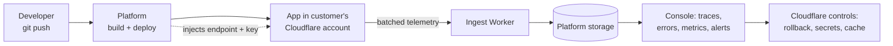

# SpaceFn Platform

Design document for the hosted platform around SpaceFn. The reporter half of Phase 0 is implemented as [`@spacefn/trail`](./trail.md); the platform services are not built yet. This document remains the plan the implementation must follow.

## Vision

SpaceFn stays an open source framework. The platform is a separate, closed service that turns a SpaceFn app into a monitored product:

- Deploy from the platform to Cloudflare.
- Tracing and monitoring work with zero configuration.
- A console shows requests, queries, errors, and frontend speed.
- A few Cloudflare controls (rollback, secrets, cache) live in the same place.

Contract for users: **use SpaceFn, deploy from the platform, get everything.**

## Principles

| Principle        | Meaning                                                                                                                                |
| ---------------- | -------------------------------------------------------------------------------------------------------------------------------------- |
| No lock-in       | The framework never hardcodes the platform. It sends telemetry to an address the deploy step injects. Self-hosters point it elsewhere. |
| Zero config      | Instrumentation is on by default. No code changes in user apps.                                                                        |
| Own account      | Apps run in the customer's own Cloudflare account. They own their data, limits, and Cloudflare bill.                                   |
| Cheap and honest | Telemetry is sampled and batched by default. Costs are visible per project in the console.                                             |

## Architecture



| Component      | Job                                                             | Runs on                                       |
| -------------- | --------------------------------------------------------------- | --------------------------------------------- |
| Deploy service | Build the app, inject config, upload the Worker, attach domains | Platform                                      |
| Reporter       | Record traces, queries, errors, frontend signals inside the app | User app (open source, part of the framework) |
| Ingest Worker  | Authenticate, validate, rate limit, store telemetry             | Platform                                      |
| Storage        | Hot data, big payloads, daily rollups                           | Platform                                      |
| Console        | Traces, error list, metrics, deploys, controls                  | Platform (a SpaceFn app)                      |
| Alert Worker   | Cron checks thresholds, sends notifications                     | Platform                                      |

## The handshake

The only wiring between app and platform is configuration injected at deploy time:

```ts
// injected by the deploy service, never committed by the user
WATCH_ENDPOINT = "https://ingest.spacefn.dev/v1/events";
WATCH_KEY = "wk_live_<project>_<env>";
```

The reporter takes these as options (`endpoint`, `key`) — `trailMiddleware` and `clientScript` receive what the deploy step injected. If they are missing, it does nothing. Every batch carries the SDK version so the console can flag outdated apps.

## Deployment model

Phase 1 (launch): deploy into the **customer's own Cloudflare account** with a scoped API token created by the user and stored encrypted by the platform.

- The platform needs only what the deploy and controls require: Workers Scripts edit, Workers Routes, D1/R2 access if the app uses them, Account Settings read.
- The user can revoke the token at any time.
- Telemetry storage is always platform-side. The customer account runs only the app.

Phase 2 (later): a fully managed tier on Workers for Platforms, where the app runs on the platform account. The telemetry pipeline does not change; only who runs the code changes.

## What the reporter records

| Signal         | Source                                       | Notes                                                              |
| -------------- | -------------------------------------------- | ------------------------------------------------------------------ |
| Request traces | `trailMiddleware` in `@spacefn/trail`        | One trace per request: loader, action, render, SSE stream          |
| DB queries     | A Kysely dialect wrapper in `@spacefn/trail` | SQL, duration, rows, error; enables slow-query and N+1 detection   |
| Outbound calls | `trailFetch` in `@spacefn/trail`             | Duration, status, target host                                      |
| Errors         | Middleware error capture, response status    | 5xx always kept regardless of sampling                             |
| Logs           | `trail.event()` in `@spacefn/trail`          | Structured, attached to the current trace                          |
| Frontend       | `clientScript` in `@spacefn/trail`           | Page render timing, web vitals, JS errors, Datastar request timing |

Trace context uses W3C Trace Context (`traceparent`) end to end. The server stamps every response; the browser script continues the same trace on Datastar requests, so a click in the browser and the server work behind it appear in one timeline.

## Telemetry pipeline

1. Spans and events are buffered in memory during the request.
2. The buffer is flushed in the background after the response finishes, so users never wait on telemetry.
3. Batches are sent with `navigator.sendBeacon` or `fetch keepalive` to the ingest endpoint.
4. Sampling is decided at flush time: every trace with an error is kept; a configurable share of clean traces is kept.

Limits that shape this design (Workers Analytics Engine, verified 2026-04):

| Limit                      | Value                   | Consequence                                    |
| -------------------------- | ----------------------- | ---------------------------------------------- |
| Data points per invocation | 250                     | Events are batched into few writes             |
| Blobs per data point       | 20 strings, 16 KB total | Big payloads go to R2                          |
| Indexes per data point     | 1, up to 96 bytes       | Trace id is the index; project lives in a blob |
| Retention                  | 3 months                | Daily rollups in D1 for long-range charts      |

## Data model

```text
account
  └── project            (e.g. "my-shop")
        └── environment  (production / preview)
              └── deployment
```

Every telemetry record carries `project_id`, `env`, `deployment_id`, and `sdk_version`. The project is taken from the ingest key, never from the payload.

Span records in Analytics Engine:

| Column       | Content                                                                   |
| ------------ | ------------------------------------------------------------------------- |
| `index1`     | `trace_id`                                                                |
| `blob1..5`   | `span_id`, `parent_span_id`, `name`, `kind`, `status`                     |
| `blob6..8`   | `project_id`, `env`, route                                                |
| `blob9..13`  | error summary, `deployment_id`, user hash, attributes JSON, `sdk_version` |
| `double1..4` | start offset ms, duration ms, HTTP status, rows or bytes                  |

Event records (breadcrumbs, logs, browser errors) are batched as JSON in one data point per flush.

Storage split:

| Store            | Holds                                                  | Why                                    |
| ---------------- | ------------------------------------------------------ | -------------------------------------- |
| Analytics Engine | Spans and events                                       | Fast time-series queries, cheap writes |
| R2               | Request bodies, HTML, stack traces, old deploy bundles | Big blobs and rollback                 |
| D1               | Hourly and daily rollups per project                   | Dashboard charts beyond 3 months       |

A rollup job runs on a cron: it reads aggregates from Analytics Engine and upserts a few rows per project per hour into D1. Dashboard queries hit D1; trace lookups hit Analytics Engine by `index1`.

## API surface

### Ingest API (used by the reporter)

| Endpoint          | Purpose                                                 |
| ----------------- | ------------------------------------------------------- |
| `POST /v1/events` | Telemetry batch. Bearer key, gzip JSON, `202` on accept |
| `GET /v1/config`  | Sample rate and feature flags for the reporter          |

Per-key rate limits and payload caps (1 MB per batch) apply. `429` carries `Retry-After`.

### Console API (used by the web console and later the CLI)

| Endpoint                                    | Purpose                                  |
| ------------------------------------------- | ---------------------------------------- |
| `GET /v1/projects/:id/overview`             | Traffic, error rate, latency percentiles |
| `GET /v1/projects/:id/traces`               | Filter by time, route, status, duration  |
| `GET /v1/projects/:id/traces/:traceId`      | One trace as a waterfall                 |
| `GET /v1/projects/:id/errors`               | Errors grouped by fingerprint            |
| `GET /v1/projects/:id/metrics`              | Rollup time series                       |
| `GET/POST /v1/projects/:id/deploys`         | Deploy list and trigger                  |
| `POST /v1/projects/:id/deploys/:n/rollback` | Re-upload an old bundle from R2          |
| `POST /v1/projects/:id/keys`                | Create or revoke ingest keys             |

## Cloudflare controls

First controls, in order of daily value:

| Control                    | How                                         | Phase |
| -------------------------- | ------------------------------------------- | ----- |
| Rollback                   | Old bundles kept in R2, re-uploaded via API | 1     |
| Secrets and env vars       | Cloudflare API                              | 1     |
| Cache purge                | Cloudflare API                              | 1     |
| Custom domains             | Cloudflare API                              | 2     |
| Log tail                   | Cloudflare API                              | 2     |
| Data browsers (D1, KV, R2) | Read APIs                                   | 2     |
| Usage and spend limits     | Platform metering                           | 2     |

## Security and privacy

- Ingest keys are write-only and scoped to one project and environment.
- Cloudflare tokens are encrypted at rest, least privilege, user revocable.
- Payload caps and per-key rate limits on ingest.
- Scrubbing rules strip common PII fields (cookies, auth headers, query secrets) before storage.
- A delete endpoint removes all stored data for a project on request.

## Cost and metering

The platform pays for Analytics Engine, R2, and D1. Metering counts events ingested and queries run per project, which drives both pricing and the per-project cost card in the console. Free tier runs at a low sample rate with a short query window; paid tiers raise sampling, retention, and add alerts.

## Roadmap

| Phase | Scope                                                                                             |
| ----- | ------------------------------------------------------------------------------------------------- |
| 0     | Reporter in the framework (traces, queries, errors, frontend), ingest Worker, one-project storage |
| 1     | Deploy from GitHub, console with traces and error list, rollback and secrets                      |
| 2     | Alerts, metrics rollups, teams, billing, remaining controls                                       |
| 3     | Managed tier on Workers for Platforms                                                             |

Phase 0 and 1 together are the MVP: a user pushes code, gets a live app, and can answer "why was that slow" and "why did that fail" without adding anything to their code.
