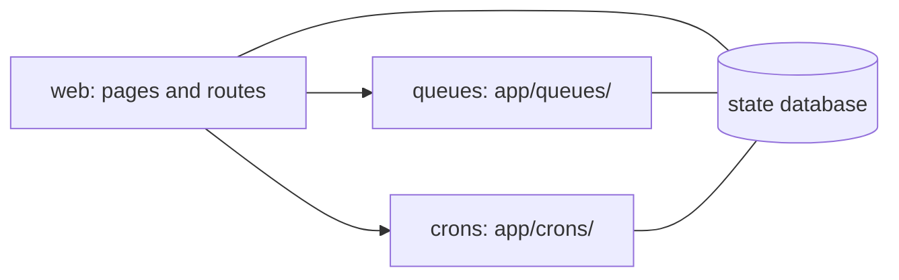

# Bun

On Bun, the app is a Docker image built from its source, run as a container with a volume for its data. The scaffolded `configs/infra.ts` builds and runs it in your local Docker; point it at a server to deploy there.

```sh
space deploy
```

## The processes

The app runs as three kinds of process: the **web** server, the **queue** consumers and the **crons**. By default the web process starts the other two as children and restarts one that crashes, so a slow or failing job never blocks or takes down a request. `SIGTERM` stops all three, and a queue process stopped mid-batch hands its messages back.



They share a libSQL **state database** behind `Kv`, `Queue`, `Bus` and `RateLimiter`: a file in the data folder by default.

## The image

`configs/Dockerfile` installs the dependencies, runs `vite build` and keeps only `dist/`. `configs/Dockerfile.dockerignore` keeps local files, such as `.env` and `.space/data`, out of it. The container gets a volume on `/data`, for file databases, the state database and blobs, and restarts unless stopped.

## Variables

| Variable          | Default                              | What it does                                                      |
| ----------------- | ------------------------------------ | ----------------------------------------------------------------- |
| `PORT`, `HOST`    | `3000`, all                          | Where the web server listens                                      |
| `SPACE_DATA_DIR`  | `.space/data` (`/data` in the image) | Local databases, the state database, blobs                        |
| `SPACE_STATE_URL` | a file in the data dir               | The state database behind Kv, Queue, Bus and RateLimiter (libSQL) |
| `DB_<NAME>_URL`   | a file in the data dir               | A libSQL database: `libsql://`, `https://` or `file:`             |
| `SPACE_ROLE`      | unset: web, starting the others      | `web`, `queues` or `crons`: run one part per process              |

## On a server

Give the image, the volume and the container a Docker context that reaches the server over SSH:

```ts [configs/infra.ts]
const context = yield * Docker.Context("Host", { docker: "host=ssh://deploy@server.example.com" });
const image = yield * Docker.Image("Image", { context /* ... */ });
const data = yield * Docker.Volume("Data", { context });
yield * Docker.Container("App", { context /* ... */ });
```

Put a reverse proxy, such as Caddy, in front of it for HTTPS.

The stack keeps its deploy state in `.alchemy/`, on the machine that deployed. To deploy from CI or from more than one machine, keep it in a shared store instead, such as `Cloudflare.state()` from `@alchemy.run/cloudflare`.

## More than one machine

Point `SPACE_STATE_URL` and the databases at a shared libSQL server (Turso or `sqld`), then run several `SPACE_ROLE=web` and `SPACE_ROLE=queues` processes, and exactly one `SPACE_ROLE=crons`. `Blob` is a local folder for now, so it needs a shared volume.

## Without Docker

```sh
space build
bun dist/server/index.js
```

runs the same thing, with the data in `.space/data` unless `SPACE_DATA_DIR` says otherwise.
