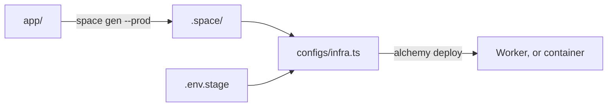

# Deployment

One command deploys the app, to the target in `configs/vite.ts`:

```sh
space deploy                    # stage prod
space deploy --stage staging    # another copy, with its own resources
space destroy --stage staging   # delete that copy, its data included
```

`space deploy` generates `.space/` for production and runs `alchemy deploy configs/infra.ts --stage <stage>`. [Alchemy](https://alchemy.run) creates or updates what the stack declares and shows you the plan to approve; `--yes` skips the question, for CI.



## Stages

A stage is a separate copy of the app: its own Worker or container, databases, queues and state. `prod` is the default. Use one per environment (`staging`, `prod`) or per pull request (`pr-42`), and `space destroy` the ones you're done with.

Each stage reads its variables from `.env.<stage>` and from the environment, never from `.env`. See [`.env`](../4-folders/8-env.md).

## Where it runs

| Target                        | What a deploy creates                                                                |
| ----------------------------- | ------------------------------------------------------------------------------------ |
| [Cloudflare](1-cloudflare.md) | A Worker with D1, KV, R2, Queues, Durable Objects and Cron Triggers, in your account |
| [Bun](2-bun.md)               | A Docker image of the app, and a container running it with a volume for its data     |

What the stack creates, and how to change it, is in [Infrastructure](3-infrastructure.md). Deploying from GitHub, GitLab or Cloudflare's own builds is in [CI/CD](4-ci-cd.md).

## Telemetry

Traces, logs and metrics go over OTLP when `OTEL_EXPORTER_OTLP_ENDPOINT` is set (with `OTEL_EXPORTER_OTLP_HEADERS` for the key), to any OpenTelemetry backend. Requests and queries are traced already; add spans with `Effect.withSpan`. The service name is the app's name unless `OTEL_SERVICE_NAME` says otherwise. `telemetry(manifest.name)` in `app/entry.ts` turns it on.

## Before the first deploy

- `space doctor` checks the tools the target needs, the config, and that `configs/infra.ts` gives every binding `app/` asks for.
- Create `.env.prod` with the production values, or set them in CI.
- On Cloudflare, enable R2 on the account, or remove the bucket from `configs/infra.ts`.
