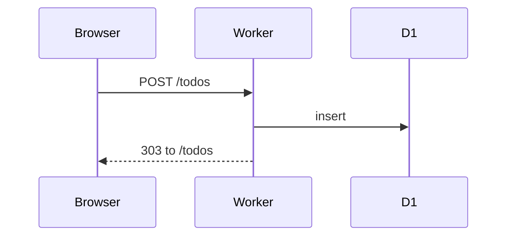

# Writing docs

`space docs` shows your app's `docs/` folder next to spacefn's docs, and `space dev` serves the same reader at `/__space/docs/`. Pages are Markdown files; edit one and the open page reloads.

## Pages and the sidebar

Every `.md` file in `docs/` is a page, and every folder is a group in the sidebar. A folder's `index.md` (or `README.md`) is its first page and names the group.

```txt
docs/
  index.md            the home page
  architecture.md
  runbooks/
    index.md          "Runbooks", the group's title
    deploys.md
    incidents.md
```

A page's title is its first `# heading`. Pages are ordered by name unless you give an order, either as a number before the name (`1.setup.md`, which the sidebar doesn't show) or in frontmatter:

```md [docs/architecture.md]
---
title: How it fits together
order: 2
description: One line, shown on the folder's cards
---

# Architecture
```

Link between pages by their file names, as you would on GitHub: `[deploys](runbooks/deploys.md)`. Put images next to the pages and link them the same way.

## Code

Fenced code is highlighted by [Shiki](https://shiki.style). Name the file in brackets after the language, and list lines to highlight in braces:

````md
```ts [app/routes/health.ts] {3}
import { Effect } from "effect";

export const GET = () => Effect.succeed(Response.json({ ok: true }));
```
````

```ts [app/routes/health.ts] {3}
import { Effect } from "effect";

export const GET = () => Effect.succeed(Response.json({ ok: true }));
```

Comments mark lines too, and the comment is left out of the page: `// [!code ++]` and `// [!code --]` for a diff, `// [!code highlight]`, `// [!code focus]`, and `// [!code error]` or `// [!code warning]`.

```ts
const limit = 10; // [!code --]
const limit = 50; // [!code ++]
const page = yield * Pages.list({ limit }); // [!code focus]
```

### Code groups

Wrap blocks in `<code-group>` to show them as tabs. Each tab is named by the block's `[title]`. Choosing a tab chooses it in every group on the page that has one with that name, and the reader remembers it:

````md
<code-group>

```sh [npm]
npm create spacefn@latest my-app
```

```sh [pnpm]
pnpm create spacefn my-app
```

</code-group>
````

<code-group>

```sh [npm]
npm create spacefn@latest my-app
```

```sh [pnpm]
pnpm create spacefn my-app
```

```sh [bun]
bun create spacefn my-app
```

</code-group>

Leave a blank line after `<code-group>` and before `</code-group>`, so the blocks inside are read as Markdown.

## Callouts

GitHub's alerts become callouts. Text after the kind names it:

```md
> [!TIP] Run it in CI
> `space db status` exits non-zero when a migration is pending.
```

> [!NOTE]
> Notes add something worth knowing.

> [!TIP] Run it in CI
> `space db status` exits non-zero when a migration is pending.

> [!IMPORTANT]
> Important is what readers must not miss.

> [!WARNING]
> Warnings are about something that can go wrong.

> [!CAUTION]
> Caution is about something that can't be undone.

## Diagrams

A `mermaid` block draws a [Mermaid](https://mermaid.js.org) diagram, in the page's light or dark theme. The browser loads Mermaid when a page has one; offline, the diagram's source shows instead.

````md

````


## HTML

HTML in a page is kept as written, so a page can have anything Markdown lacks. Markdown inside an HTML block works when a blank line follows the opening tag:

```html
<details>
	<summary>What's in .space/?</summary>

	Generated code: the route table, typed queries, and the Worker or server entry.
</details>
```

<details>
<summary>What's in .space/?</summary>

Generated code: the route table, typed queries, and the Worker or server entry.

</details>

A few classes are styled for you:

| Markup                                       | Shows                                                                                                                                                             |
| -------------------------------------------- | ----------------------------------------------------------------------------------------------------------------------------------------------------------------- |
| `<span class="badge tip">new</span>`         | A badge: <span class="badge">note</span> <span class="badge tip">tip</span> <span class="badge warning">warning</span> <span class="badge caution">caution</span> |
| `<div class="callout tip">`                  | A callout, like `> [!TIP]`, for content an alert can't hold                                                                                                       |
| `<div class="steps">` around `###` headings  | Numbered steps                                                                                                                                                    |
| `<div class="cards">` around a list of links | A grid of cards                                                                                                                                                   |
| `<kbd>⌘</kbd> <kbd>K</kbd>`                  | Keys: <kbd>⌘</kbd> <kbd>K</kbd>                                                                                                                                   |

<div class="steps">

### Write the migration

Add `app/db/main/migrations/0002_add_done.sql`.

### Write the query

Add `app/db/main/queries/todos/mark-done.sql`; `space gen` types it.

### Call it

`yield* MainDb.todos.markDone({ id })` in a route or a page action.

</div>

<div class="cards">

- [Database](database.md)<br>Migrations and typed queries
- [Pages](pages.md)<br>Server-rendered pages and forms
- [Testing](testing.md)<br>Pages, routes and queries in memory

</div>

A page can also have a `<style>` or a `<script>` of its own, for a small live example.

## Searching

<kbd>⌘</kbd> <kbd>K</kbd> or <kbd>/</kbd> searches both doc sets: page titles, headings, and the text under each heading.
